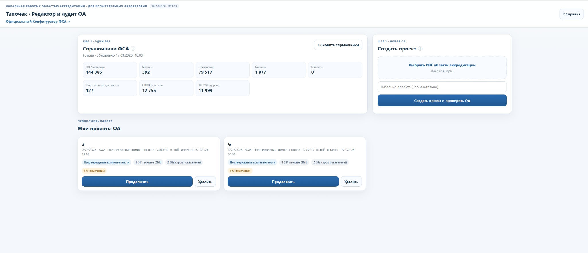
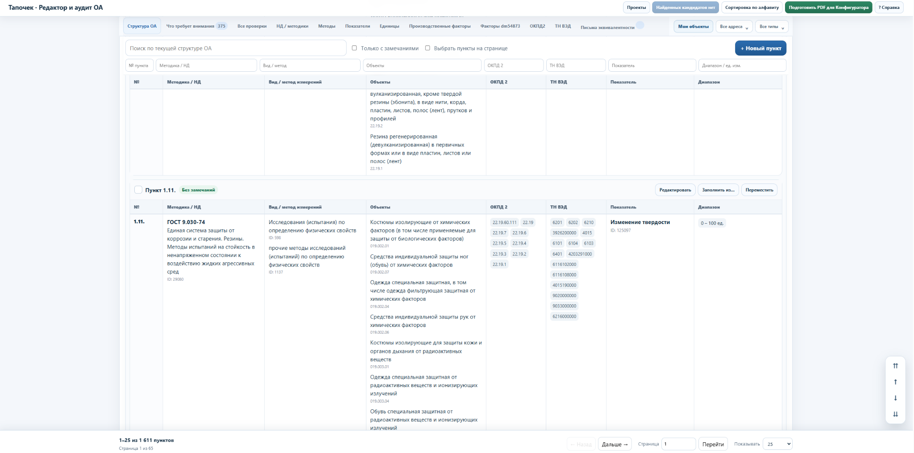
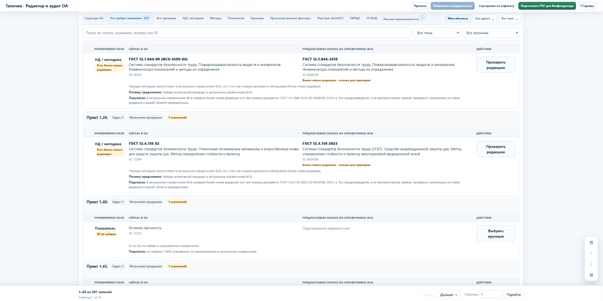

# Тапочек (Tapochek)

**Тапочек** — бесплатная независимая программа для просмотра и редактирования областей аккредитации испытательных лабораторий.

Программа помогает работать со структурой области аккредитации и подготавливать файлы для последующей проверки в официальном Конфигураторе областей аккредитации Росаккредитации.

> **Текущий публичный выпуск:** [0.7.8 RC9.1](https://github.com/labinforu/tapochek/releases/tag/v0.7.8-rc9.1) — предварительная версия (*Pre-release*) для Windows 10/11 x64. Исходный код программы в этом репозитории не публикуется.

## Скачать

**[Скачать установщик Tapochek-0.7.8-rc9.1-Setup.exe](https://github.com/labinforu/tapochek/releases/download/v0.7.8-rc9.1/Tapochek-0.7.8-rc9.1-Setup.exe)**

- [Что нового в RC9.1](https://github.com/labinforu/tapochek/releases/tag/v0.7.8-rc9.1)
- [SHA-256 нового установщика](https://github.com/labinforu/tapochek/releases/download/v0.7.8-rc9.1/Tapochek-0.7.8-rc9.1-Setup.exe.sha256)
- [Инструкция по установке и обновлению](INSTALL.md)
- [История версий](CHANGELOG.md)
- [Предыдущая версия RC8](https://github.com/labinforu/tapochek/releases/tag/v0.7.8-rc8)

Скачивайте установщик только из [Releases](https://github.com/labinforu/tapochek/releases) этого репозитория. Перед запуском рекомендуется проверить SHA-256 в соответствии с инструкцией.

## Как выглядит программа

Ниже — реальные скриншоты версии 0.7.8 RC8. Нажмите на изображение, чтобы открыть его в полном размере.

### Главная страница и создание проекта

Встроенные справочники ФСА, создание нового проекта на основе PDF и продолжение работы с ранее сохранёнными областями аккредитации.

### Редактор области аккредитации

Таблица пунктов ОА с методиками, методами испытаний, объектами, кодами ОКПД2 и ТН ВЭД, показателями и диапазонами. Доступны поиск, фильтрация и редактирование.

### Аудит и проверка справочных данных

Просмотр замечаний, сопоставление значений с подключёнными справочниками, поиск возможных новых редакций НД и предложения для ручной проверки. Предлагаемые замены не следует считать автоматическим подтверждением применимости новых документов.

## Возможности программы

- Импорт областей аккредитации из PDF, просмотр и редактирование данных.
- Подготовка и экспорт данных в XML для проверки в официальном конфигураторе.
- Работа с методиками, методами, показателями, единицами измерения и другими элементами области аккредитации.
- Шесть включённых в комплект справочников: нормативные документы, методы испытаний, показатели, единицы измерения, ОКПД2 и ТН ВЭД ЕАЭС.
- Автоматическое первичное подключение справочников и готового локального поискового индекса — без самостоятельной загрузки Excel-файлов.
- Работа с локальными данными без необходимости постоянного подключения к интернету.

**Важные ограничения:** справочные данные включены по состоянию пользовательской библиотеки на 23 сентября 2026 года и не обновляются автоматически. Вспомогательные каталоги ОКПД2/ТН ВЭД не гарантируют полноту и актуальность всех внутренних идентификаторов; отдельного полного справочника объектов испытаний нет.

## Что нового в 0.7.8 RC9.1

- **Статистика АРП по выбранному нормативному документу:** встречающиеся у других испытательных лабораторий методы, показатели, объекты, коды и диапазоны; частота отдельных вариантов записи.
- **Проверки сохранности методов:** дополнительный контроль структуры и исторических связей при редактировании и экспорте.
- **Проверка обновлений GitHub:** ручная и фоновая проверка новых версий, выбор канала обновлений и контроль SHA-256.

**Важно:** статистика показывает распространённость записей, **а не их правильность**. Один и тот же НД может быть записан разными способами и учитываться раздельно; распространённый вариант не обязательно подходит для Вашей ОА. Некоторые выдачи ограничены первыми 100 результатами, а отчёт по загруженным пунктам использует выборку до **100 пунктов**, а не всю большую ОА. Для статистики нужны интернет, сервер АРП и действующий аккаунт; локальные функции «Тапочка» остаются бесплатными.

При работе со старыми ОА проверяйте соответствие исторических ID и наименований методов, методик и показателей текущим справочникам, особенно перед передачей сведений во ФГИС.

Полный список изменений и оговорок: [описание RC9.1](https://github.com/labinforu/tapochek/releases/tag/v0.7.8-rc9.1).

## Установка и первый запуск

1. Скачайте установщик по ссылке выше и проверьте контрольную сумму.
2. Запустите файл `Tapochek-0.7.8-rc8-Setup.exe` и ознакомьтесь с лицензионным соглашением.
3. Запустите установленную программу через ярлык. Отдельно устанавливать Python не требуется.
4. При первом запуске дождитесь подключения встроенных справочников. Для локального индекса рекомендуется иметь около 2 ГБ свободного места в пользовательском профиле.
5. Не закрывайте служебное консольное окно во время работы — оно необходимо локальному серверу приложения.
6. При обновлении с RC8 сначала сохраните резервную копию пользовательских проектов и установите RC9.1 вручную. После обновления можно пользоваться встроенной проверкой следующих выпусков.

Подробности: [INSTALL.md](INSTALL.md).

## Ограничения и проверка результатов

Это предварительный выпуск. В программе возможны ошибки и ограничения совместимости с текущими и будущими версиями официального конфигуратора.

**Сохраняйте исходные документы и обязательно проверяйте результаты редактирования в официальном Конфигураторе областей аккредитации Росаккредитации перед практическим использованием.** Успешный экспорт XML сам по себе не подтверждает корректность всех его данных.

[Источники данных и особенности совместимости](DATA_SOURCES_AND_LIMITATIONS.md).

## Сообщить об ошибке или предложить улучшение

В разделе [Issues](https://github.com/labinforu/tapochek/issues/new/choose) доступны две русскоязычные формы: сообщение об ошибке и предложение по улучшению.

**GitHub Issues общедоступны.** Не прикладывайте необезличенные области аккредитации, PDF/XML с персональными данными, секреты, пароли и конфиденциальные материалы.

Контакт по вопросам программы: **aas@lab-info.ru**.

## Лицензия и статус проекта

Программа распространяется бесплатно в соответствии с пользовательским лицензионным соглашением, включённым в установщик. Собственный исходный код программы не опубликован; для сторонних компонентов действуют условия их собственных лицензий, тексты которых включены в дистрибутив.

**«Тапочек» — независимое программное обеспечение проекта Lab-Info.** Программа не является официальным продуктом Росаккредитации, не разработана по её поручению и не предполагает официального одобрения Росаккредитацией.
